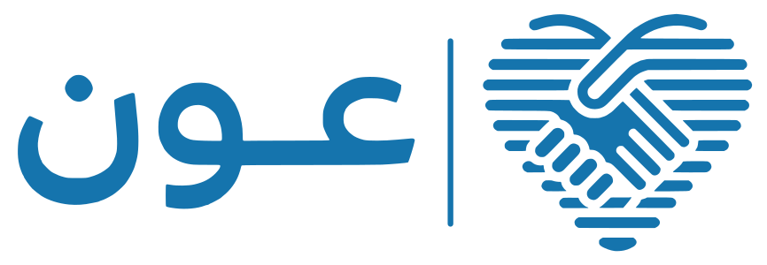

<p align="center"></p>

# عون · Aoun

**عون** is an AI agent from the Ministry of Health that calls people in white Saudi dialect (or in their own language), finds out what is stopping them from getting their early screening, fixes it on the call and books it in Sehhaty. The Ministry then sees each neighbourhood's reasons and fixes them for everyone.

agentX hackathon · Ministry of Health track (early screening in neighbourhoods).

## The four parts

| Part | Where | What it does |
|---|---|---|
| **Call agents** رُفيدة / رفيد | ElevenLabs (`agents/`) | Phone call in Saudi dialect + 6 languages. Asks the one reason, solves it (ride, after-work time, mobile clinic, home visit, female doctor…), reads the plan back, books in Sehhaty. |
| **Mobile app** | `mobile/` (Expo, React Native) | Care plan with cost, route (Google/Apple Maps, Uber, Careem, Darb), calendar, health notebook, medicines, doctor messages, neighbourhood awareness and events, «حيّ عون» game, neighbourhood walk, in-app voice assistant that reads everything aloud. |
| **Doctor portal** | `backend/app/static/doctor.html` → `/doctor` | The doctor's patients, results, notes, medicines and messages. Results feed the app and the Ministry board. |
| **Ministry board** | `backend/board/` → `/ministry/board` | Kingdom → region → city → district. Live counts from the pilot, **صوت الأحياء** (why people don't get screened, per district, and what worked), and interventions approved with one click that add real bookable times in the app. |

Everything goes through one server (`backend/`, FastAPI + SQLite), so a change in one interface shows in the others.

## Repository

```
agents/              agent prompts (the source of truth for what each agent says)
  rufaida_prompt.md  rafeed_prompt.md            phone calls (women / men)
  rufaida_app_prompt.md  rafeed_app_prompt.md    in-app voice assistant
  elevenlabs/agents.json   ids, model, voices per language, first messages, tool list, settings
  elevenlabs/tools.json    every tool's full definition (webhook URL, parameters, descriptions)
backend/             FastAPI server: webhook tools for the agents, patient API, doctor portal, Ministry board
  README.md          the server in detail (privacy, every endpoint, the call step by step, deploy)
  board/             Ministry board source (Ministry.dc.html + live.js) → build.py → app/static/ministry.html
  tests/             56 tests: python -m pytest -q
mobile/              Expo app (README.md inside: structure, adding an agent, building on a phone)
brand/               the logo: SVG + PNG, light / dark / navy versions, app icon
prototypes/          the three interfaces as single HTML files (open in any browser, no server needed)
render.yaml          one-click deploy of the server on Render
```

## Brand

Taken from the logo: navy `#002336`, sky `#59C2F9`, brand blue `#1574AD` (buttons and links on white), ink `#0E2E45`, soft blue `#E5F3FC`. All three interfaces use the same palette. The app's is in `mobile/src/theme.ts`.

The companion colours are chosen to go with the blue:
- **Gold `#F2B33D`** (dark `#7A4E00`, soft `#FFF3DC`) for highlights, walking and warnings.
- **Indigo `#3E3E8F`** for a second category.
- **Red `#8A2A1C`** for danger only.

Logo files are in `brand/`. The main logo is `lockup-h-*`: the heart, a line, then «عون», all in one colour (blue on white, sky or white on navy).

Other versions:
- `lockup-light`: on white.
- `lockup-dark` or `lockup-white`: on dark.
- `lockup-on-navy`: comes with its own navy background.
- `mark-*`: the heart alone.
- `word-*`: the word alone.
- `icon`: the app icon.

## Run it

**Server**

```bash
cd backend
pip install -r requirements.txt
export AOUN_TOOL_KEY=dev-tool-key AOUN_ADMIN_KEY=dev-admin-key AOUN_WEBHOOK_SECRET=dev \
       AOUN_PHONE_ENC_KEY=$(python -c "from cryptography.fernet import Fernet;print(Fernet.generate_key().decode())") \
       AOUN_DEMO_MODE=1
uvicorn app.main:create_app --factory --port 8000
```

- Doctor portal: http://localhost:8000/doctor (demo doctors D01–D21; the demo password is in `backend/README.md`).
- Ministry board: http://localhost:8000/ministry/board (`M01` / `aoun-ministry-2026` in demo mode).
- In demo mode (`AOUN_DEMO_MODE=1`) both the board and the doctor portal open straight away, with no sign-in (the portal as د. ريم الشهري, D03). With demo mode off, the sign-in forms come back.
- Tests: `python -m pytest -q`.

After editing the board's design or `live.js`, run `python board/build.py`.

**App**

```bash
cd mobile
npm install
npx tsc --noEmit
npx expo start                               # screens only
npx eas-cli build -p ios --profile development   # voice agents need a dev build (WebRTC)
```

The app talks to `https://aoun-voice-tools.onrender.com` by default (`src/config.ts`). To use another server, set `extra.apiBase` in `app.json`. The app holds no secret key.

**Deploy the server:** on Render, choose New → Blueprint and pick this repo (`render.yaml`). Set:
- `ELEVENLABS_API_KEY` and `ELEVENLABS_PHONE_NUMBER_ID` for real phone calls;
- optionally `AOUN_GOOGLE_MAPS_KEY` and `AOUN_MINISTRY_PASSWORD`.

The SQLite database resets on each deploy. Demo mode seeds it again.

## The agents (ElevenLabs)

| Agent | id | Voice | Tools |
|---|---|---|---|
| رُفيدة, calls | `agent_9701m8d18596fbv8ghbf9jk4we3c` | `o0oG1TnHDWDdKbAeBgCO` | 9 server webhooks |
| رفيد, calls | `agent_3801m8d1800xe1dbvm93n5dg3gay` | `O7RAXQn7KXIEqLr2JNyO` | 9 server webhooks |
| رُفيدة, app | `agent_1501m8ef5ggye2a9q13mtb0rvkzj` | `o0oG1TnHDWDdKbAeBgCO` | 6 tools that run on the phone |
| رفيد, app | `agent_5601m8ef72qze8yv81t5v27tfqe0` | `O7RAXQn7KXIEqLr2JNyO` | 6 tools that run on the phone |

All four agents use the same core setup:
- **Speech:** ElevenLabs Scribe v3 for listening, `eleven_v4` for the voice.
- **Model:** Gemini 3.5 Flash at temperature 0.3.
- **Languages:** Arabic, English, Urdu, Hindi, Bengali, Filipino and Indonesian, each with its own voice.

The agents live in the team's ElevenLabs account. To recreate them in another account:
1. Create the webhook tools from `agents/elevenlabs/tools.json`. Each one sends the header `X-Aoun-Tool-Key` from an ElevenLabs secret that holds the server's `AOUN_TOOL_KEY`.
2. Create the client tools from the same file.
3. Create each agent with its prompt from `agents/*.md` and its settings from `agents/elevenlabs/agents.json`.
4. Put the new agent ids in `mobile/src/agents/*.ts` and in the server's `AOUN_AGENT_RUFAIDA` / `AOUN_AGENT_RAFEED`.

The model doesn't decide anything medical and never invents times. Slots, prices, Sehhaty and privacy all come from the server's tools.

## Privacy, in short

**What the agents may ask:** they never ask for an ID, password, code, bank details or a relative's details.

**What gets stored:**
- Only the last 4 digits of an ID. Phone numbers are encrypted, and IDs and phones are masked wherever they're shown.
- No genetic results.
- The agents see nothing from the person's record. The phone reads it aloud itself.

**What the Ministry sees:** only counts per district built from fixed codes. Any count under 5 is hidden.

`backend/README.md` covers all of this in detail.

## Before the demo

- Rotate `AOUN_TOOL_KEY` (Render) and the matching ElevenLabs secret.
- Decide whether ElevenLabs should keep call audio and transcripts. It currently keeps them; zero-retention mode would keep nothing.
- Make one real call after deploying.
- Never commit `.env` or any key.
